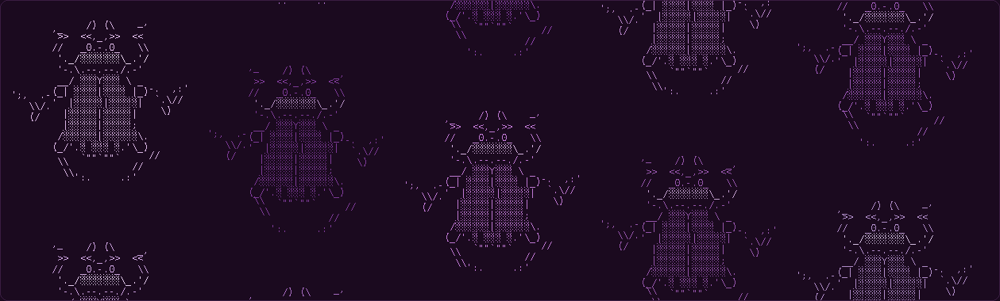

<h1 align="center">LG Erdmann</h1>

  

---

### Projetos

- [whiskers-game](https://github.com/LGErdmann/whiskers-game)
- [Warhammer](https://github.com/LGErdmann/Warhammer)
- [EA-tree-system](https://github.com/LGErdmann/EA-tree-system)
- [GA---Beatle](https://github.com/LGErdmann/GA---Beatle)
- [Gráfico de linhas paralelas com k-means](https://github.com/LGErdmann/Gr-fico-de-linhas-paralelas-com-aux-lio-de-k-means)
- [EDA1-EDA2](https://github.com/LGErdmann/EDA1-EDA2)

### Estatísticas

  
  

